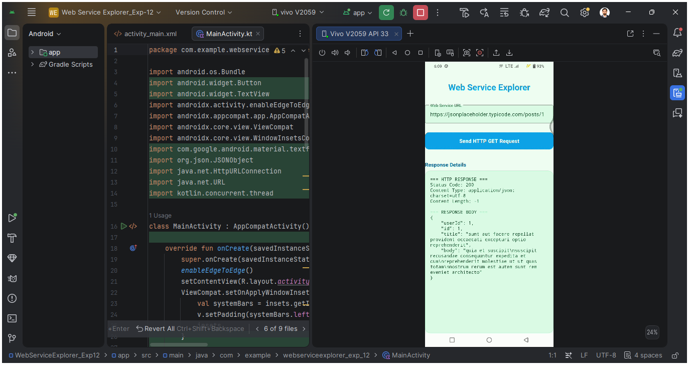
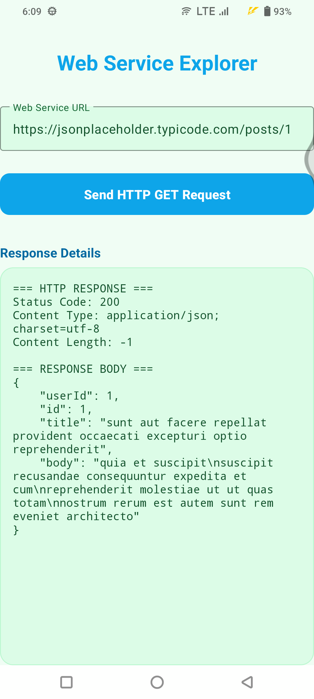
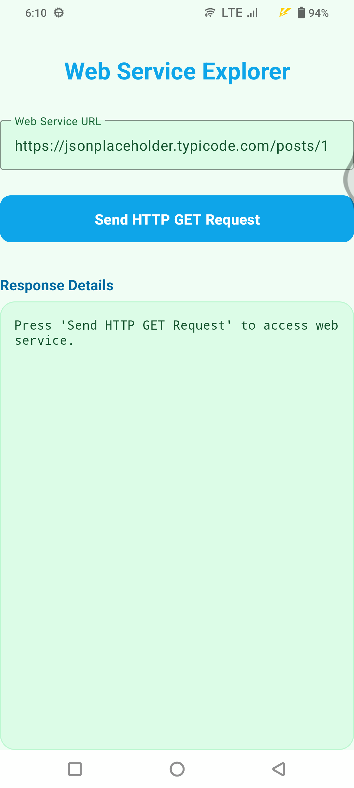

# MAD Experiment 12: Access Web Services Using HTTP Requests in Android

## Aim
To access a web service from an Android application using HTTP requests, receive the server response, and display the response details in the application.

## Description
**Web Service Explorer** is an Android application developed using Kotlin and XML. It demonstrates how an Android app communicates with a REST web service using an HTTP GET request. The app allows the user to enter a web service URL, send a request, and view the HTTP status code, content type, content length, and JSON response body.

## Technologies Used
- Android Studio
- Kotlin
- XML layouts
- HTTP GET request
- `HttpURLConnection`
- JSON
- JSONPlaceholder REST API

## Features
- Simple, user-friendly interface
- Editable web service URL
- Send HTTP GET requests
- Fetch data from a REST API
- Display HTTP response status code
- Display content type and content length
- Display the JSON response body
- Perform network operations on a background thread

## API Used

**JSONPlaceholder**

```text
https://jsonplaceholder.typicode.com/posts/1
```

**HTTP Method:** `GET`

The API returns a sample post in JSON format:

```json
{
  "userId": 1,
  "id": 1,
  "title": "sunt aut facere repellat provident occaecati excepturi optio reprehenderit",
  "body": "quia et suscipit suscipit recusandae consequuntur expedita et cum reprehenderit molestiae ut ut quas totam nostrum rerum est autem sunt rem eveniet architecto"
}
```

## Project Structure
```text
WebServiceExplorer_Exp12/
├── app/
│   └── src/main/
│       ├── java/com/example/webserviceexplorer_exp_12/
│       │   └── MainActivity.kt
│       ├── res/layout/
│       │   └── activity_main.xml
│       └── AndroidManifest.xml
├── gradle/
├── .gitignore
├── build.gradle.kts
├── gradle.properties
├── settings.gradle.kts
└── README.md
```

*Note: The package directory and Gradle files may vary depending on the project configuration.*

## Source Code

### 1. Internet Permission

Add the internet permission in `AndroidManifest.xml`, outside the `<application>` tag:

```xml
<uses-permission android:name="android.permission.INTERNET" />
```

### 2. HTTP GET Request — Kotlin Example

This example demonstrates opening an HTTP connection, sending a GET request, and reading the response. Adapt the view IDs and response-display logic to the actual project implementation.

```kotlin
import java.net.HttpURLConnection
import java.net.URL

// Run this network operation on a background thread.
val url = URL("https://jsonplaceholder.typicode.com/posts/1")
val connection = url.openConnection() as HttpURLConnection

try {
    connection.requestMethod = "GET"
    connection.connectTimeout = 10000
    connection.readTimeout = 10000

    val statusCode = connection.responseCode
    val contentType = connection.contentType
    val contentLength = connection.contentLength

    val responseStream =
        if (statusCode in 200..299) connection.inputStream
        else connection.errorStream

    val responseBody = responseStream?.bufferedReader()?.use {
        it.readText()
    } ?: ""

    // Display statusCode, contentType, contentLength,
    // and responseBody on the Android UI thread.

} finally {
    connection.disconnect()
}
```

### 3. Background Thread

Network requests should not run on Android's main UI thread. Perform the request on a background thread and update the UI on the main thread.

```kotlin
Thread {
    // Perform the HTTP request here.

    runOnUiThread {
        // Update TextViews or other UI components here.
    }
}.start()
```

## Screenshots

<table>
  <tr>
    <th>1. Send HTTP Request</th>
    <th>2. Message from Web Service</th>
  </tr>
  <tr>
    <td align="center">
      
    </td>
    <td align="center">
      
    </td>
  </tr>
  <tr>
    <th>3. HTTP Request Output</th>
    <th>4. Initial Application Message</th>
  </tr>
  <tr>
    <td align="center">
      
    </td>
    <td align="center">
      
    </td>
  </tr>
</table>

## HTTP Request and Response
- **HTTP request:** The application sends a GET request to the URL entered by the user.
- **Status code:** Indicates the result of the request. For example, `200` means the request was successful.
- **Content type:** Identifies the response format, such as `application/json`.
- **Content length:** Indicates the response size when provided by the server. A value of `-1` means the length is not known.
- **Response body:** Contains the data returned by the web service, displayed as JSON text.

## How to Run
1. Clone or download the repository:

   ```bash
   git clone https://github.com/Vishwajeetsingh22/MAD-Experiment-12-Web-Service-Explorer.git
   ```

2. Open the project in Android Studio.
3. Wait for Gradle sync to complete.
4. Connect an Android device or start an emulator.
5. Make sure the device has an internet connection.
6. Run the application.
7. Enter a valid REST API URL, or use the default JSONPlaceholder URL.
8. Tap **Send HTTP GET Request**.
9. View the HTTP response details and JSON response body in the app.

## Concepts Demonstrated
- Internet permission in Android
- Web services and REST APIs
- HTTP GET requests
- `HttpURLConnection`
- HTTP response codes and headers
- JSON response data
- Background threading for network operations
- Updating the Android UI after a network request

## Author
**Vishwajeet Singh**  
**USN:** 25MCAR0219  
**JAIN DEEMED TO BE UNIVERSITY**

## GitHub Repository
[ MAD-Experiment-12-Web-Service-Explorer ](https://github.com/Vishwajeetsingh22/MAD-Experiment-12-Web-Service-Explorer)

## Result
The **Web Service Explorer** Android application was developed and executed successfully. It sends an HTTP GET request to a REST API and displays the server's response details and JSON data.

---

**Mobile Application Development (MAD) — Experiment 12**
